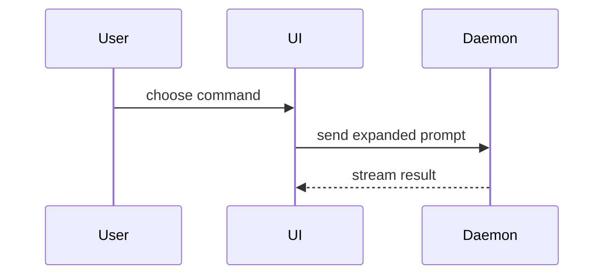

## Draft from the actual change

1. Inspect the actual final diff and the relevant base revision. Include the user's requested local changes only when they are part of the requested PR scope. Check the working-tree state so committed, unstaged, and staged changes are not confused.
2. Identify the user-visible or maintainer-visible behavior that changed and describe it in the Summary as **Before** and **After**. Derive Before from the Git baseline, source, documentation, or capability that existed before the change; derive After from the actual change. For a new feature, say that the previous version did not support it. Do not drop this comparison just because no old-version test run was recorded.
3. Choose the smallest visual form that explains the change. It may show changed files, calls, states, and boundaries, plus a related unchanged caller or module when its role is verified in source and helps explain the change. Label unchanged elements as context so they are not mistaken for part of the diff.
4. Gather verification evidence separately from the change description. Name checks actually run for this change, their observed results, and anything not verified. Report a result for a version only when that version was actually run and produced the reported result. Claim an old-fails/new-passes execution comparison only when both versions were run. If only the new version ran, report its result and explicitly say the old version was not run; keep the mandatory source-based Before/After description. Pseudocode can explain the intended behavior but is not execution evidence. Never invent a failure, screenshot, output, test pass, or runtime claim.
5. Describe rollback and impact from the actual change. Mark the door as two-way only when a rollback is practical; name the concrete affected surface rather than listing hypothetical possibilities.
6. Return a review-ready body in the requested location or response. A writing-only request produces a draft and does not create or update a PR. If the user has already explicitly authorized a commit, push, PR creation/update, or publish action within this scope, carry it out without asking again; do not exceed that authorization.

Use this template for writing the PR body:

```markdown
## Summary

**Before:** <what the existing behavior, capability, or documentation supported; for a new feature, say it was not supported>

**After:** <what the actual change now supports or changes>

<diagram, diff-sketch, or tree>

## Evidence

- **Checks run:** <exact command or action and the result actually observed>
- **Not verified:** <runtime, platform, or other checks not performed; write “None” only when appropriate>

## Merge Danger

**Door:** <one-way or two-way>

<optional: description>

**Blast Radius:** <one-word description>

<optional: potential ramifications of merge>
```

## Sections

Skip all preambles and keep prose brief. Use the user's domain language from `GLOSSARY.md`.

### Summary

Pick the smallest view that makes the key point clear.

- Show logic or an algorithm as pseudocode:

```text
on(save)
  if content is unchanged
    return cached result
  write new content
  return fresh result
```

- Show runtime control flow as a call tree:

```text
submitForm
  createSession
    persistPrompt
    launchAgent
  navigateToSession
```

- Show UI structure as a component tree, including state and module boundaries that matter:

```text
<SessionPage> (apps/example/src/routes/session.tsx)
  useSessionEvents()
  <SessionToolbar>
    <RunSkillButton> (packages/ui)
```

- Show file responsibility or a broad refactor as a shallow file tree:

```text
src/
├── commands/       # parses user actions
├── sessions/       # owns session state
└── transport/      # sends API requests
```

- Show component interaction, control flow, or data flow with Mermaid:



- Use `diff` when the point is what changes and the surrounding shape already exists. Match the diff shape to the topic.

For a component change:

```diff
 <SessionPage>
   useSessionEvents()
   <SessionToolbar>
+    <RunSkillButton />
   <SessionTimeline>
+    <SkillResultCard />
```

For a file-layout change:

```diff
 src/
 ├── commands/
+│   └── show-me.ts       # expands the slash command
 ├── sessions/
-└── transport.ts
+└── transport/
+    ├── client.ts
+    └── stream.ts
```

For a call-tree or call-stack change:

```diff
 submitForm
   createSession
     persistPrompt
+    expandSkillMention
     launchAgent
-  navigateToSession
+  navigateToSession
+    subscribeToEvents
```

For a state or control-flow change:

```diff
 on(save)
-  write content
+  if content is unchanged
+    return cached result
+  write new content
+  invalidate cache
```

- Show the whole block when most of it is new, when omitted context would hide ownership or order, or when the user needs a copyable target shape:

```ts
function expandSkill(command: string): string {
  const skillName = command.slice(1);
  return `use the ${skillName} skill`;
}
```

#### Guidance

Place each visual next to the short text it supports. Keep only the calls, files, props, states, and boundaries needed to explain the current change or resolve the current discussion point. A related unchanged caller or module may be included when its source has been checked and it clarifies how the change is used; identify it as unchanged context.

You may use one of these, you may use several, it is unlikely you will use all of them. Use your judgement and don't overwhelm the user.

### Evidence

Keep the change comparison in **Summary** and execution evidence here. Every PR with an actual change needs a Before/After description based on the baseline and current diff, source, documentation, or supported capability. A new feature's Before state is that the previous version did not support it. This description does not claim that the old and new versions were run.

List the actual checks run for the change, the result observed, and any unverified behavior. If no checks ran, say so; lack of an old-version runtime record does not remove the Before/After description.

For visual changes, a real screenshot can be strong evidence when one already exists or can be captured within the authorized work.

Execution-based evidence includes test results and console output. Name the exact check and report the output actually observed. Report a result for a version only when that version was actually run and produced the reported result. Claim an old-fails/new-passes execution comparison only when both versions were run. If only the new version ran, report its result and explicitly say the old version was not run; keep the mandatory source-based Before/After description. Pseudocode explains behavior and cannot stand in for a test result.

### Merge Danger

Describe whether it is a one-way or two-way door using the actual rollback cost. A change that is cheap to revert is lower risk; destructive or hard-to-reverse changes are one-way doors.

The blast radius is the concrete area this diff can affect. Name the impacted users, modules, interfaces, or devices supported by the changed code; do not inflate it with unrelated hypotheticals.
